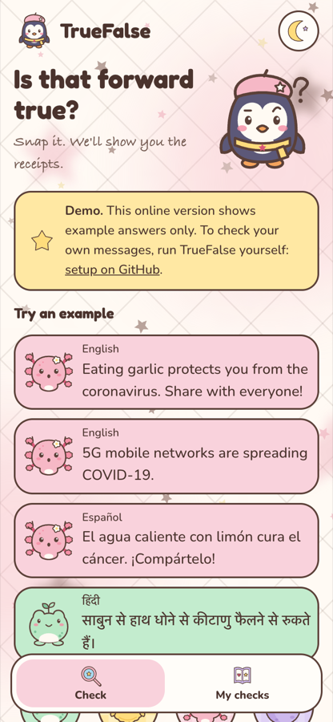
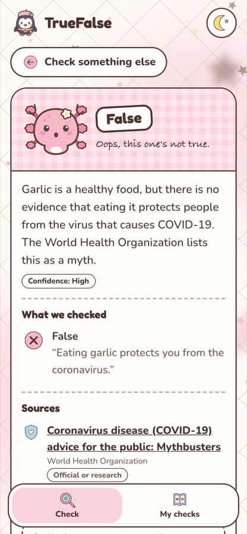
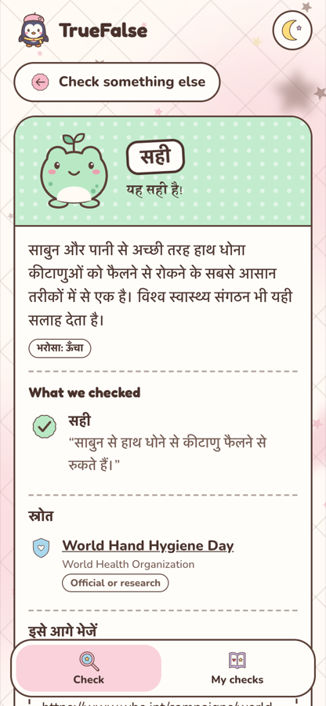

# TrueFalse

**Is that forward true? Snap it. TrueFalse shows you the receipts.**

Send it a forwarded message, screenshot, photo, voice note or link, in any language. It answers
**True**, **Misleading**, **False** or **Unverified**, shows the sources it used, and writes a
kind reply you can send back to the group chat.

If no source backs an answer, it says **Unverified** instead of guessing.

<p>
  
  
  
</p>

## Try it

**https://arushish5-cyber.github.io/truefalse/**


Scan with your phone's camera, then "Add to Home Screen" to install it like an app. The online
demo shows saved example answers. To check your own messages, run it on your laptop (below).

## Host it for free (always on)

The web app runs on GitHub Pages and the checker on [Render](https://render.com)'s free plan
(no card needed). In Render: **New > Blueprint**, pick this repo, paste your Gemini key when it
asks. Then copy the service address (like `https://truefalse.onrender.com`) into this repo's
**Settings > Secrets and variables > Actions > Variables** as `TRUEFALSE_API_URL`, and rerun the
"Web app site" action. The free checker sleeps after 15 quiet minutes; the next check wakes it in
about a minute.

## Run it on your laptop

You need [Node](https://nodejs.org), [uv](https://docs.astral.sh/uv/) and ffmpeg (for voice, video and iPhone photos)
(`brew install node uv ffmpeg`), plus a free [Gemini API key](https://aistudio.google.com/apikey).

```bash
cp .env.example .env          # first time only
python3 scripts/set_key.py    # copy your key first; saves it into .env without showing it
./run.sh                      # opens on http://localhost:3200
```

To share it with anyone (a class, a demo), run `./run.sh --share`. It prints a public link that
works on any phone, with uploads and real answers, while that window stays open. It allows up to
100 checks a day in total, so a shared link can't use up your key (`DAILY_CHECK_LIMIT` in `.env`).

Use `./run.sh --phone` to open it on a phone on the same Wi-Fi instead.

## Use it inside WhatsApp, Instagram and other apps

**Share button (any app, no setup).** On Android, open the `--share` link, tap "Add to Home
screen", then in WhatsApp, Instagram, TikTok, X or YouTube tap **Share → TrueFalse** on any
message, photo, video or post. On iPhone, copy or screenshot it and open TrueFalse.

**Chat bots.** People message TrueFalse in WhatsApp, Instagram DMs or Facebook Messenger and get
the answer back in the chat. Each needs a free Meta developer app
([developers.facebook.com](https://developers.facebook.com/apps)) with that product added:

| App | What to copy into `.env` | Where |
|---|---|---|
| WhatsApp | `WHATSAPP_TOKEN`, `WHATSAPP_PHONE_ID`, `WHATSAPP_APP_SECRET` | WhatsApp > API Setup; App settings > Basic |
| Instagram | `INSTAGRAM_TOKEN`, `INSTAGRAM_APP_SECRET` | Instagram > API setup with Instagram login (needs a free Creator or Business account) |
| Messenger | `MESSENGER_PAGE_TOKEN`, `MESSENGER_APP_SECRET` | Messenger > API Setup (needs a Facebook Page) |

Copy the lines as `NAME=value`, run `python3 scripts/set_key.py`, then `./run.sh --share`. It
prints a callback URL and verify token for each app: paste them into that app's **Webhooks**
settings and subscribe to `messages`. While the Meta app is in development mode, only people you
add as testers can message the bot.

## What's in here

| Folder | What it is |
|---|---|
| `web/` | The app (Next.js), installable on phones |
| `extension/` | Chrome extension: right-click any text, link or image to check it |
| `backend/` | The checker: reads the media, searches sources, three AI judges vote |
| `scripts/` | Key setup and the doodle generator |

## How it checks

1. Reads the message, picture, voice note or link and pulls out the claims
2. Searches fact-checkers, PubMed, Semantic Scholar and Wikipedia
3. Three AI judges vote on each claim, using only those sources
4. Drops anything the sources don't back, then answers in your language

## Privacy

What you check is sent to the AI and search services. Uploads are deleted within 15 minutes, and
answers are kept for up to 24 hours. With Gemini's free tier, Google may use what you send to
improve its products, so don't check private messages.

## Tests

```bash
cd backend && uv sync --extra media && uv run pytest
```

More detail: [PROGRESS.md](PROGRESS.md) and [CONTRIBUTING.md](CONTRIBUTING.md).

## License

MIT. Made by Arushi Nirmal. Fonts: Fredoka and Nunito (SIL Open Font License).
